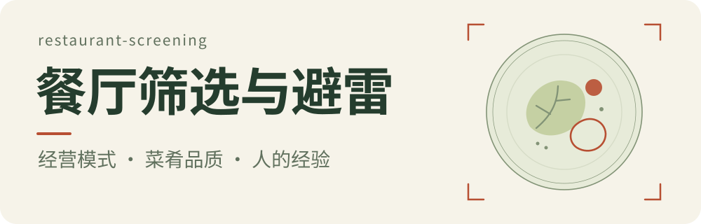

<picture>
  <source media="(prefers-color-scheme: dark)" srcset="assets/hero-dark.svg">
  <source media="(prefers-color-scheme: light)" srcset="assets/hero.svg">
  
</picture>

# 餐厅筛选与避雷

[](SKILL.md) [](LICENSE)

一个以食物品质为核心的中文 Agent Skill。用它筛选餐厅、分析菜单和名厨餐厅，也可以检查一份美食推荐是否值得参考。

它采用食物优先、对资本化和标准化出品从严的筛选偏好。完整筛选综合**经营模式、菜肴品质、人的经验**；只问菜单、主厨或推荐者时，使用对应部分。

## 安装到 Codex

让 Codex 使用内置安装器：

```text
用 skill-installer 安装这个仓库的根目录 Skill，名称为 restaurant-screening：
https://github.com/haorantang97/restaurant-screening
```

也可以在终端手动安装（需要 Git，且目标文件夹尚不存在）：

```sh
mkdir -p "${CODEX_HOME:-$HOME/.codex}/skills"
git clone https://github.com/haorantang97/restaurant-screening.git \
  "${CODEX_HOME:-$HOME/.codex}/skills/restaurant-screening"
```

安装后，在下一轮对话中使用 `$restaurant-screening`。已通过 Git 克隆安装的副本，可在该目录执行 `git pull --ff-only` 更新。

## 使用

**筛选餐厅**

```text
用 $restaurant-screening 帮我比较这三家餐厅，预算每人 100 美元：
[餐厅名及城市／官网链接]
```

**分析菜单或推荐**

```text
用 $restaurant-screening 看这份菜单，分析食材、设计和烹饪。
[菜单文字、链接或图片]
```

```text
用 $restaurant-screening 看这份美食推荐是否值得参考。
[推荐内容及推荐者公开资料]
```

输出先回答是否值得考虑，再解释影响选择的规则与具体资料。例如，面对一份只强调名店研修经历的高价菜单，会检查训练时长和岗位、实际掌厨情况，以及食材和菜肴能否支撑价位；有明确食材供应方时，也可以反查其供应的其他餐厅。

## 看哪些方面

| 方面 | 关注内容 |
| --- | --- |
| 经营模式 | 餐饮集团和品牌关联、名厨集团、连锁、资本集中的地区、酒店与度假村 |
| 菜肴品质 | 食材出处和品质、菜肴设计、主厨实际下厨、精密烹饪、发酵方式 |
| 人的经验 | 主厨的训练与持续学习、推荐者的饮食阅历、复吃与食物分析能力 |

全部规则放在一个 [SKILL.md](SKILL.md) 中；[agents/openai.yaml](agents/openai.yaml) 提供 Codex 中的名称、简介与默认提示词。

## 使用范围

- 适合把食物品质放在首位、愿意采用上述严格筛选偏好的人。规则包含具体地区的取舍及个别品牌例外，使用前可阅读全文。
- 需要查阅当前餐厅信息时，依赖宿主 Agent 的搜索或浏览能力；也可分析用户直接提供的菜单和资料。
- 对具体事实附来源，资料未提供的情况如实说明；图片只能支持可见内容的分析，无法代替实际品尝。

已完成 Skill 格式、文件引用和内容合并检查。餐厅筛选效果尚未经过真实用餐结果验证。

## 参与改进

发现规则歧义、信息过时或执行问题，可按 [贡献说明](CONTRIBUTING.md) 提交 Issue 或 Pull Request。

## 许可

[PolyForm Noncommercial 1.0.0](LICENSE)：允许非商业使用、修改和分发；商业使用需另行取得许可。
